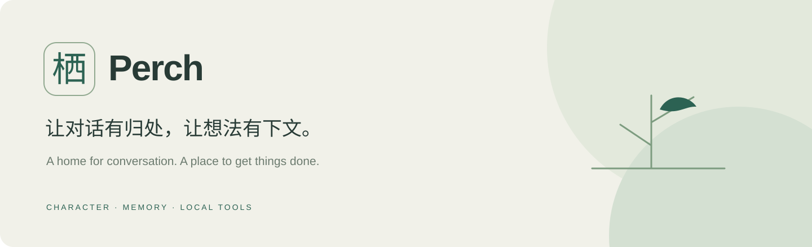
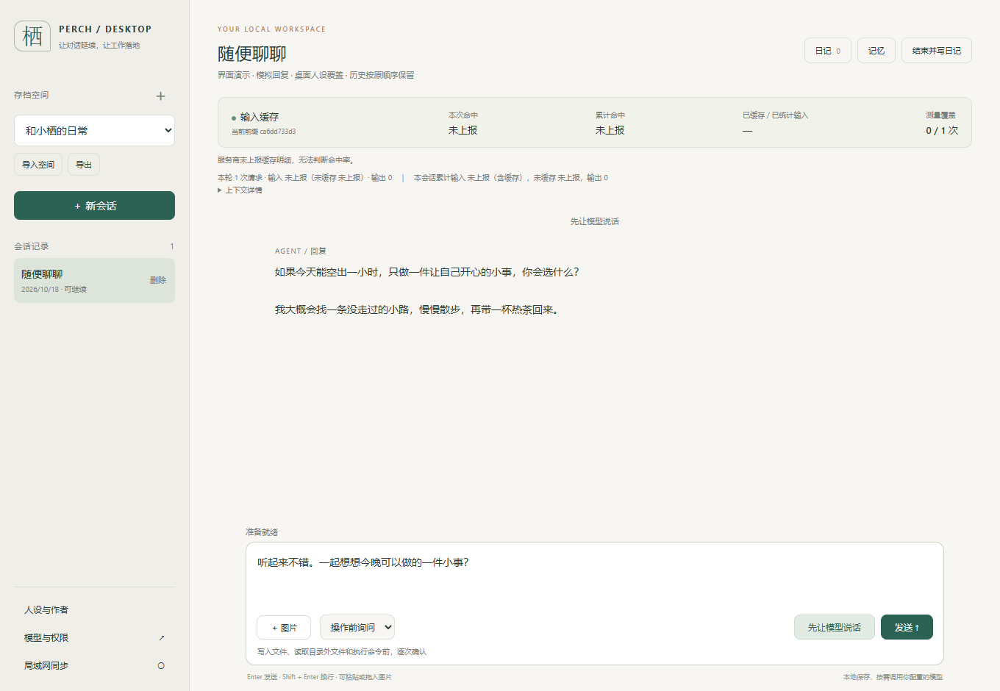

<p align="center"></p>

<p align="center">
  <a href="https://github.com/aatymmsy/-/actions/workflows/ci.yml"></a>
  
  <a href="LICENSE"></a>
  
</p>

<p align="center"><b>一个有性格、记得住、能做事的桌面 AI。</b><br>中文 · <a href="README.en.md">English</a> · <a href="#三分钟开始">快速开始</a> · <a href="https://github.com/aatymmsy/-/issues">反馈与想法</a></p>

栖（Perch）给 AI 一个安静的桌面空间。你可以定义它的性格，聊今天的小事，让它记住重要的约定，也可以把整理文件、编写内容和运行命令交给它。聊天、记忆、日记和工作都在同一个界面里。

**你选择模型。你保留记录。你决定它能做什么。**



<sub>真实应用界面，使用独立演示数据和模拟回复；截图中的内容不代表商业模型实测，也不包含个人记录。</sub>

## 从聊天，到一起完成一件事

| 你想做的事 | 栖如何接住 |
| --- | --- |
| 想聊天，却没想好话题 | 点「先让模型说话」，当前角色自然开场；未发送的草稿和图片仍保留 |
| 希望每次交流都有延续 | 自定义人设、会话快照、短条记忆；结束时可生成日记 |
| 让 AI 处理手边工作 | 读取与写入文本、查看图片、列出目录、运行命令，显示实际执行结果 |
| 先看清楚，再允许操作 | 默认逐次确认写入、外部文件读取和命令，也可选仅工作目录或完全访问 |
| 看清上下文的成本 | 展示服务商返回的输入、输出和缓存用量；未上报就显示未知 |
| 网络出错后接着做 | 停止、重试、输出接续、完整历史；重试不会重复添加用户消息 |

## 三分钟开始

安装 [Node.js 24 或更新版本](https://nodejs.org/)，然后：

```sh
git clone https://github.com/aatymmsy/-.git perch
cd perch
npm start
```

打开 **http://127.0.0.1:39781**。运行应用无需先执行 `npm install`。

1. 打开「模型与权限」，填写接口地址与自己的 API Key，点击「同步模型」或手填模型 ID。
2. 打开「人设与作者」，写下角色设定并保存。
3. 发送一句话，或者点击「先让模型说话」。

Windows 可以双击 `启动.cmd`，用 Edge 应用窗口打开；`停止.cmd` 会关闭本地服务。关闭窗口本身不会停止后台任务。浏览器界面和后端也可在 Linux 上运行；Windows 原生启动器仅支持 Windows。

没有 Key 也能先看界面：运行 `npm run demo`，打开 **http://127.0.0.1:39871**。演示使用临时数据和固定模拟回复，不调用外部模型。

## 模型由你选

支持 **Chat Completions 兼容接口**，内置 OpenAI、DeepSeek、Kimi、硅基流动、百炼、Ollama、LM Studio 与自定义地址入口。模型列表来自你填写的服务商，不内置账号或额度。

文本聊天需要模型支持聊天接口；文件工作需要工具调用能力；图片理解需要视觉能力。能列出某个模型，不代表它支持所有功能。当前没有原生 Responses 或 Anthropic 协议适配。

## 首轮缓存：优化前缀，诚实计量

v0.2 把提示词组织为：

```text
固定规则 → 表达与记忆规则 → 人设 → 运行环境 → 日记 → 短条记忆 → 对话
└──────────────── 更容易复用 ────────────────┘   └──── 经常变化 ────┘
```

新日记、新记忆不再挡在固定规则之前；相同人设的新会话能保留更长的一致前缀。普通聊天转为日记时也保留固定规则。旧会话继续使用原快照，**新建会话后采用新的前缀布局**。

首次遇到的新前缀仍需要服务商建立缓存，缓存过期、模型变化、路由与历史压缩也可能降低命中。应用不会通过额外付费预热、重复请求或填充无用文本来美化百分比；这里没有“首轮必定高命中”的承诺。

详情与可复现验证：[缓存设计](docs/cache-design.md)。统计以接口实际 `usage` 为准，CI 验证前缀稳定性，不模拟商业模型的真实命中率。

## 数据与权限

聊天、空间、日记、记忆和配置默认保存在项目的 `data/`。没有内置账号系统或遥测。使用云模型时，本轮上下文及你提供的图片会发送给所选服务商；使用本地兼容服务可以把模型请求留在本机。

- API Key 保存在本机配置文件中，目前是明文，不进入空间导出；请保管好 `data/`。
- 管理服务只监听 `127.0.0.1`，检查 Host、Origin 与页面令牌。
- 工具确认是应用权限机制，不是操作系统沙箱。完全访问和已批准命令具备当前账户权限。
- 文本工具覆盖文件前备份；任意命令的副作用不能保证回滚。
- 备份时先停止服务，再复制整个 `data/`，包括 SQLite 的相关文件。

可用环境变量：`PERCH_DATA`（数据目录）、`PERCH_PORT`（本机端口）、`PERCH_API_KEY`（当前配置地址的密钥）。不要把密钥写进仓库。

## 验证与开发

```sh
npm ci
npm run check
npm test
npx playwright install chromium
npm run test:ui
```

GitHub Actions 执行 Windows / Linux 后端回归、源码语法与发布文件检查、Chromium 界面测试，以及 Windows 启动器构建。测试使用临时目录和本机模拟接口，不需要密钥，不调用收费模型。

| 目录 | 职责 |
| --- | --- |
| `src/` | 本地 HTTP、SQLite、模型请求、上下文、记忆、权限与工具 |
| `public/` | 原生 HTML / CSS / JavaScript 界面 |
| `tests/` | 后端回归与浏览器交互测试 |
| `scripts/` | 演示服务、发布检查与 Windows 打包 |

没有前端框架，也没有运行时 npm 依赖。Playwright 仅用于开发验证。运行 `npm run build:windows` 可构建带启动器的便携 ZIP；仍需安装 Node.js 24+。

## 一起把它做得更好

欢迎提交可复现问题、角色表达体验和真实工作场景。先读 [贡献指南](CONTRIBUTING.md)；发现安全问题请看 [安全说明](SECURITY.md)。

接下来关注：更清楚的成本诊断、更多模型协议、可移植的角色模板。路线是计划，不是已经完成的能力。

如果你喜欢这种安静、可掌控的桌面 AI，欢迎点一个 **Star**，或把项目分享给会用到它的人。

遵循仓库原有的 [Mozilla Public License 2.0](LICENSE)。
